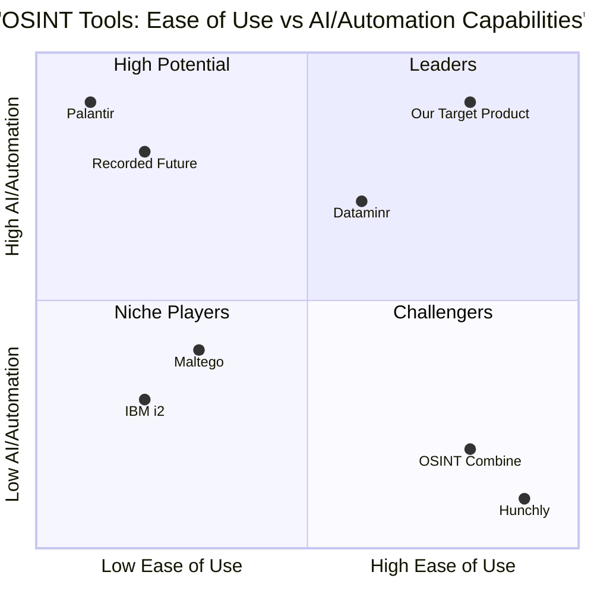

# Product Requirements Document (PRD)
# AI-Powered OSINT Report Generator

## Project Information
- **Language**: English
- **Programming Language**: Shadcn-ui, TypeScript, Tailwind CSS
- **Project Name**: osint_report_generator
- **Document Version**: 1.0
- **Date**: August 24, 2025

## Original Requirements
To build an intelligent, AI-powered OSINT report generator that allows users (Private Investigators, analysts, etc.) to submit any type of raw information about a person (text, images, links, usernames, notes, etc.), and automatically compiles it into a professionally formatted, well-analyzed report — optionally enhanced by Gemini for content summarization and insight extraction.

## Product Definition

### Product Goals
1. **Streamline Intelligence Reporting**: Reduce manual report writing time by 80% while maintaining professional quality and accuracy through AI-powered automation and structured templates.

2. **Enhance Analytical Capabilities**: Leverage Gemini AI to extract actionable insights, identify patterns, and generate comprehensive analysis from unstructured data sources including text, images, and multimedia content.

3. **Ensure Professional Compliance**: Provide secure, audit-trail enabled platform that meets law enforcement and legal professional standards with robust data protection and evidence-grade documentation capabilities.

### User Stories

1. **As a Private Investigator**, I want to upload disparate data sources (social media screenshots, notes, documents) into a single platform so that I can generate a comprehensive, professional report for my client within hours instead of days.

2. **As a Law Enforcement Analyst**, I want AI-powered entity recognition and relationship mapping so that I can quickly identify connections between suspects, locations, and events from large volumes of unstructured data.

3. **As a Security Analyst**, I want automated threat intelligence compilation so that I can transform raw OSINT data into actionable security reports with risk assessments and mitigation recommendations.

4. **As an OSINT Researcher**, I want a drag-and-drop interface with AI analysis so that I can efficiently process multimedia evidence and generate timeline-based investigative reports with proper source attribution.

5. **As a Legal Professional**, I want secure, exportable reports with audit trails so that I can present intelligence findings as admissible evidence while maintaining chain of custody documentation.

### Competitive Analysis

#### Primary Competitors

**1. Maltego**
- *Strengths*: Industry leader in link analysis and data visualization, strong investigative analytics capabilities, excellent relationship mapping
- *Weaknesses*: Complex learning curve, limited AI integration, primarily focused on network analysis rather than comprehensive reporting
- *Market Position*: Established player in cybercrime investigations

**2. Recorded Future**
- *Strengths*: Real-time threat intelligence, predictive analytics, strong cybersecurity focus, extensive data source coverage
- *Weaknesses*: Expensive enterprise pricing, limited customization for individual investigators, primarily threat-focused
- *Market Position*: Leading threat intelligence platform

**3. Palantir Technologies**
- *Strengths*: Powerful big data analytics, government-grade security, comprehensive data integration, advanced visualization
- *Weaknesses*: Enterprise-only focus, extremely high cost, complex deployment, overkill for individual investigators
- *Market Position*: Major enterprise and government market leader

**4. IBM i2 Analyst's Notebook**
- *Strengths*: Mature analytical capabilities, law enforcement adoption, strong visualization tools
- *Weaknesses*: Legacy interface, limited modern AI integration, high licensing costs
- *Market Position*: Traditional law enforcement favorite

**5. Dataminr**
- *Strengths*: Real-time social media monitoring, AI-powered alerts, breaking news detection
- *Weaknesses*: Limited report generation, focused on monitoring rather than analysis
- *Market Position*: Strong in real-time intelligence

**6. OSINT Combine**
- *Strengths*: User-friendly interface, affordable pricing, OSINT-specific features
- *Weaknesses*: Limited AI capabilities, smaller data source coverage
- *Market Position*: Growing player in accessible OSINT tools

**7. Hunchly**
- *Strengths*: Browser integration, evidence collection focus, investigator-friendly design
- *Weaknesses*: Limited analysis capabilities, no AI integration, manual report generation
- *Market Position*: Popular among individual investigators

### Competitive Quadrant Chart

## Technical Specifications

### Requirements Analysis

The AI-powered OSINT report generator must address several critical technical challenges in the intelligence analysis market:

1. **Multi-Source Data Integration**: Handle diverse data types including text documents, images, videos, links, and structured data from 500+ sources across surface, deep, and dark web.

2. **AI-Powered Analysis**: Integrate Google Gemini API for natural language processing, entity recognition, relationship mapping, and insight generation from unstructured data.

3. **Professional Report Generation**: Automated creation of investigation-grade reports with proper formatting, evidence chain documentation, and export capabilities.

4. **Security and Compliance**: Enterprise-grade security measures to protect sensitive investigation data while maintaining legal admissibility standards.

5. **Scalable Architecture**: Support for individual investigators to enterprise teams with role-based access controls and collaborative features.

### Requirements Pool

#### P0 Requirements (Must-Have)

**Core Platform Requirements**
- **REQ-001**: Rich text input editor supporting markdown, drag-and-drop file uploads, and multimedia content
- **REQ-002**: File upload system supporting images (JPEG, PNG, GIF), documents (PDF, DOCX, TXT), and video files up to 100MB
- **REQ-003**: Google Gemini API integration for content analysis, entity extraction, and insight generation
- **REQ-004**: Automated report generation with predefined sections: Executive Summary, Subject Profile, Key Findings, Source List, Evidence, Timeline, AI Insights
- **REQ-005**: Export functionality to PDF, DOCX, and HTML formats with professional formatting
- **REQ-006**: User authentication and authorization system with role-based access controls
- **REQ-007**: Data encryption in transit (TLS 1.3) and at rest (AES-256)
- **REQ-008**: Local storage option for offline work and data sovereignty requirements

**AI Analysis Requirements**
- **REQ-009**: Entity recognition for names, phone numbers, email addresses, locations, usernames, IP addresses
- **REQ-010**: Relationship mapping between identified entities with confidence scoring
- **REQ-011**: Timeline generation from date-stamped content and metadata
- **REQ-012**: Pattern recognition for identifying duplicate accounts, inconsistent information, and suspicious activities
- **REQ-013**: Content summarization and key insight extraction from uploaded materials
- **REQ-014**: Multi-language support for content analysis (minimum 50 languages)

#### P1 Requirements (Should-Have)

**Enhanced Analysis Features**
- **REQ-015**: Risk scoring system for fraud potential, impersonation detection, and threat assessment
- **REQ-016**: OCR capabilities for extracting text from scanned documents and images
- **REQ-017**: Facial recognition and comparison across uploaded images
- **REQ-018**: Geospatial analysis and mapping for location-based intelligence
- **REQ-019**: Social network analysis and visualization of connections
- **REQ-020**: Sentiment analysis of text content and social media posts
- **REQ-021**: Real-time collaboration features for team investigations

**Platform Integration**
- **REQ-022**: API integrations with external OSINT sources (VirusTotal, Shodan, etc.)
- **REQ-023**: Single Sign-On (SSO) support for enterprise authentication
- **REQ-024**: Audit logging and chain of custody documentation
- **REQ-025**: Custom branding and watermarking for reports
- **REQ-026**: Advanced search and filtering within case data
- **REQ-027**: Data export/import capabilities for case sharing

#### P2 Requirements (Nice-to-Have)

**Advanced Features**
- **REQ-028**: Browser extension for direct content capture
- **REQ-029**: Mobile application for field data collection
- **REQ-030**: Advanced visualization tools (network graphs, timeline views)
- **REQ-031**: Integration with Maltego, Hunchly, and other OSINT tools
- **REQ-032**: Custom report templates and formatting options
- **REQ-033**: Multi-subject comparison and analysis
- **REQ-034**: Automated background enrichment from public databases
- **REQ-035**: Machine learning model training on user-specific patterns

### UI Design Draft

#### Main Dashboard
- **Navigation Bar**: Logo, main menu (Cases, Reports, Settings, Profile), user avatar
- **Quick Actions Panel**: New Case, Upload Data, Generate Report, Export buttons
- **Recent Cases Grid**: Thumbnail view of recent investigations with progress indicators
- **Statistics Widget**: Cases completed, AI insights generated, reports exported

#### Case Management Interface
- **Three-Panel Layout**:
  - Left Panel: File tree and data sources
  - Center Panel: Rich text editor and content viewer
  - Right Panel: AI insights and analysis results
- **Drag-Drop Zone**: Visual upload area with progress indicators
- **Data Tagging**: Tag assignment interface for organizing content
- **Timeline View**: Chronological arrangement of evidence and findings

#### Report Generation
- **Section Builder**: Modular report sections with drag-and-drop reordering
- **Live Preview**: Real-time report preview with formatting
- **AI Suggestions**: Recommended content and insights integration
- **Export Options**: Format selection with custom branding options

#### Analysis Dashboard
- **Entity Graph**: Interactive visualization of identified entities and relationships
- **Confidence Meters**: Visual indicators for AI analysis confidence levels
- **Insight Cards**: Categorized findings with supporting evidence
- **Risk Assessment**: Visual risk scoring with detailed explanations

### Open Questions

1. **Gemini API Rate Limits**: What are the optimal API call strategies to balance cost, performance, and analysis depth while staying within usage quotas?

2. **Data Retention Policies**: How long should case data be retained in the system, and what automated purging mechanisms are needed for compliance?

3. **Multi-Tenant Architecture**: Should the platform support true multi-tenancy for agencies with client separation requirements, or focus on single-tenant deployments?

4. **Integration Priorities**: Which third-party OSINT tools should be prioritized for integration based on user feedback and market demand?

5. **Compliance Certifications**: What specific security certifications (SOC 2, FedRAMP, etc.) are required for target customer segments?

6. **Offline Capabilities**: What level of offline functionality is required for field investigators without reliable internet access?

7. **Training Data**: How will the AI models be trained and updated to improve accuracy for investigative use cases while maintaining privacy?

## User Workflows and Use Cases

### Primary Workflow: Complete Investigation Report Generation

**Scenario**: Private investigator conducting due diligence on a potential business partner

**Steps**:
1. **Case Creation**: User creates new case with subject name and basic information
2. **Data Collection**: Upload social media screenshots, LinkedIn profile, company documents, news articles
3. **AI Analysis**: System processes uploaded content, extracting entities and relationships
4. **Manual Review**: User reviews AI findings, adds additional context and notes
5. **Report Generation**: Automated report creation with all findings and evidence
6. **Review and Edit**: User modifies report sections, adds conclusions
7. **Export and Delivery**: Final report exported to PDF for client delivery

**Success Criteria**: Complete professional report generated in under 2 hours (vs. 8-16 hours manually)

### Secondary Workflow: Real-Time Investigation Support

**Scenario**: Law enforcement analyst tracking suspects across multiple platforms

**Steps**:
1. **Multi-Source Upload**: Batch upload of surveillance photos, social media captures, phone records
2. **Pattern Recognition**: AI identifies common elements across sources (faces, locations, timestamps)
3. **Timeline Construction**: Automatic chronological arrangement of evidence
4. **Relationship Mapping**: Visual network showing connections between individuals
5. **Alert Generation**: System flags suspicious patterns or inconsistencies
6. **Collaborative Review**: Team members add annotations and additional evidence
7. **Evidence Package**: Formatted report suitable for legal proceedings

### Tertiary Workflow: Threat Intelligence Analysis

**Scenario**: Corporate security analyst investigating potential insider threat

**Steps**:
1. **Data Ingestion**: Import employee communications, access logs, external communications
2. **Behavioral Analysis**: AI identifies anomalous patterns in communications and access
3. **Risk Scoring**: Automated assessment of threat level based on multiple factors
4. **Mitigation Recommendations**: AI-generated suggestions for security measures
5. **Executive Summary**: High-level report for management decision-making

## Target User Personas

### Persona 1: Licensed Private Investigator
**Demographics**: 35-55 years old, 10+ years investigative experience, small firm or solo practice
**Technical Proficiency**: Moderate, comfortable with basic software but not highly technical
**Pain Points**: 
- Manual report writing consumes 40-60% of billable time
- Difficulty organizing multi-source evidence
- Client demands for faster turnaround times
- Need for professional-looking deliverables
**Goals**: 
- Reduce administrative overhead
- Increase case capacity
- Improve report quality and consistency
- Maintain competitive advantage
**Usage Pattern**: 5-10 cases per month, primarily background checks and due diligence

### Persona 2: Law Enforcement Intelligence Analyst
**Demographics**: 28-45 years old, criminal justice or related degree, government employment
**Technical Proficiency**: High, experienced with various analytical tools and databases
**Pain Points**:
- Volume of digital evidence overwhelming manual analysis
- Need for legally admissible documentation
- Pressure for rapid threat assessment
- Inter-agency information sharing challenges
**Goals**:
- Accelerate case resolution
- Improve evidence correlation
- Ensure court-ready documentation
- Support field operations with timely intelligence
**Usage Pattern**: 20-50 cases per month, varying complexity levels

### Persona 3: Corporate Security Analyst
**Demographics**: 30-50 years old, cybersecurity or intelligence background, Fortune 500 employment
**Technical Proficiency**: Very high, familiar with enterprise security tools and platforms
**Pain Points**:
- Threat landscape constantly evolving
- Need for proactive risk identification
- Integration with existing security stack
- Executive reporting requirements
**Goals**:
- Automate routine threat analysis
- Provide actionable intelligence to leadership
- Integrate OSINT with technical security measures
- Demonstrate security ROI
**Usage Pattern**: Continuous monitoring with 10-20 formal reports monthly

### Persona 4: OSINT Researcher/Journalist
**Demographics**: 25-40 years old, journalism or research background, media or academic institution
**Technical Proficiency**: Moderate to high, self-taught OSINT techniques
**Pain Points**:
- Time-intensive verification process
- Need for source attribution and credibility
- Ethical considerations in data collection
- Publishing deadlines pressure
**Goals**:
- Accelerate fact-checking and verification
- Maintain source credibility and attribution
- Produce compelling data-driven stories
- Ensure ethical compliance
**Usage Pattern**: Project-based, 2-5 major investigations monthly

## Market Research Analysis

### Market Size and Opportunity

The OSINT market represents a significant and rapidly growing opportunity:

**Current Market Size (2024)**:
- Global OSINT Market: $12.13-18.20 billion
- Threat Intelligence Segment: $13.56-14.59 billion
- Combined addressable market: ~$25-33 billion

**Growth Projections**:
- 2030 Market Size: $38.02-58.0 billion (OSINT) + $22.97-36.53 billion (Threat Intelligence)
- Combined CAGR: 15.87%-24.8%
- Total addressable market by 2030: ~$60-95 billion

**Key Growth Drivers**:
1. Escalating cybersecurity threats requiring proactive intelligence
2. AI and machine learning integration creating new analytical capabilities
3. Explosive growth in digital data sources requiring sophisticated processing
4. Regulatory compliance requirements driving demand for documentation

### Market Segmentation

**By End User (Target Segments)**:
- Government Intelligence Agencies: 39.1% revenue share
- Cybersecurity Organizations: 29.8% market share
- Financial Services: 15.2% projected CAGR
- Corporate Risk Management: Expanding adoption
- Legal and Investigative Services: Underserved segment with high growth potential

**By Technology Focus**:
- Social Media Analytics: 42.6% market share
- Security Analytics: 27.7%-34% market share
- AI-Powered Analysis: Fastest growing segment

**Geographic Distribution**:
- North America: 36.0%-44.8% market share (primary target)
- Asia-Pacific: 14.3%-28.5% CAGR (expansion opportunity)
- Europe: Significant market with strong data privacy requirements

### Competitive Landscape Analysis

**Market Leaders**:
- Fortinet (Overall threat intelligence leader)
- Recorded Future (Real-time intelligence)
- Palantir (Enterprise big data analytics)
- IBM (Traditional law enforcement)

**Market Gaps**:
1. **SMB-Focused Solutions**: Most platforms target large enterprises, leaving individual investigators and small firms underserved
2. **AI Integration**: Limited sophisticated AI analysis in user-friendly packages
3. **Report Generation**: Most tools focus on analysis but lack comprehensive reporting
4. **Cost-Effectiveness**: Premium pricing excludes smaller market segments
5. **Ease of Use**: Complex interfaces require extensive training

### Strategic Positioning

**Blue Ocean Opportunity**: The intersection of AI-powered analysis, user-friendly interface, and comprehensive reporting for SMB market represents an underserved niche with significant growth potential.

**Differentiation Strategy**:
1. **AI-First Approach**: Gemini integration as core differentiator
2. **Report-Centric Design**: End-to-end solution from data to deliverable
3. **Accessible Pricing**: Target 50-70% cost reduction vs. enterprise solutions
4. **User Experience Focus**: Investigator-friendly interface requiring minimal training

## Success Metrics and KPIs

### Primary Success Metrics

**User Adoption and Engagement**
- **Monthly Active Users (MAU)**: Target 1,000 users by month 12, 5,000 by month 24
- **User Retention Rate**: 80% 30-day retention, 60% 90-day retention, 40% annual retention
- **Time to First Value**: Users generate first report within 2 hours of registration
- **Feature Adoption Rate**: 70% of users utilize AI analysis features within first month

**Product Performance**
- **Report Generation Time**: Average time reduction of 80% compared to manual processes
- **AI Analysis Accuracy**: 95% accuracy in entity recognition, 90% in relationship mapping
- **System Response Time**: Sub-5 second AI analysis for typical data sets
- **Export Success Rate**: 99% successful report exports across all formats

**Business Metrics**
- **Revenue Growth**: $500K ARR by end of year 1, $2M ARR by end of year 2
- **Customer Acquisition Cost (CAC)**: Target under $200 for individual users, $1,000 for enterprise
- **Customer Lifetime Value (CLV)**: Target CLV:CAC ratio of 3:1 minimum
- **Net Promoter Score (NPS)**: Target NPS of 50+ indicating strong user satisfaction

### Secondary Success Metrics

**Quality and Reliability**
- **Report Accuracy Rate**: 95% of AI-generated insights verified as accurate by users
- **System Uptime**: 99.9% availability with planned maintenance windows
- **Data Security Incidents**: Zero security breaches or data compromises
- **Customer Support Resolution**: 90% of issues resolved within 24 hours

**Market Penetration**
- **Market Share**: Capture 1% of target SMB segment within 24 months
- **Geographic Expansion**: Launch in 3 additional countries by month 18
- **Partnership Growth**: 10 integration partnerships with complementary tools
- **Enterprise Adoption**: 50 enterprise customers by month 24

### Key Performance Indicators (KPIs)

**Daily Tracking**
- Daily active users and session duration
- Reports generated and exported
- AI API usage and costs
- System performance metrics

**Weekly Tracking**
- New user registrations and onboarding completion
- Customer support ticket volume and resolution times
- Feature usage analytics and user feedback
- Revenue and billing metrics

**Monthly Tracking**
- User retention cohort analysis
- Net revenue churn and expansion
- Product roadmap progress and delivery
- Competitive analysis and market positioning

**Quarterly Tracking**
- Overall business performance against targets
- Customer satisfaction surveys and NPS
- Market share analysis and competitive benchmarking
- Strategic initiative progress and pivots

## Security and Compliance Requirements

### Data Protection Standards

**Encryption Requirements**
- **In Transit**: TLS 1.3 encryption for all data transmission
- **At Rest**: AES-256 encryption for all stored data including files, databases, and backups
- **Key Management**: Hardware Security Module (HSM) for encryption key storage and rotation
- **End-to-End**: Optional client-side encryption for highly sensitive investigations

**Access Control**
- **Multi-Factor Authentication (MFA)**: Required for all users with support for TOTP, SMS, and hardware tokens
- **Role-Based Access Control (RBAC)**: Granular permissions based on user roles and case assignments
- **Session Management**: Automatic session timeout, concurrent session limits, and device tracking
- **Audit Logging**: Comprehensive logging of all user actions, data access, and system events

### Compliance Framework

**International Standards**
- **ISO 27001**: Information Security Management System implementation
- **SOC 2 Type II**: Annual audits for security, availability, and confidentiality
- **GDPR Compliance**: Data protection for European users including right to deletion and data portability
- **CCPA Compliance**: California consumer privacy protections and disclosure requirements

**Industry-Specific Requirements**
- **CJIS Compliance**: FBI Criminal Justice Information Services security policy for law enforcement
- **FedRAMP**: Federal risk and authorization management program for government use
- **FIPS 140-2**: Federal information processing standards for cryptographic modules
- **Common Criteria**: International standard for IT security certification

### Data Governance

**Data Classification**
- **Public**: Marketing materials and general product information
- **Internal**: Business data and operational information
- **Confidential**: Customer data and investigation materials
- **Restricted**: High-risk investigations and sensitive personal information

**Data Lifecycle Management**
- **Collection**: Explicit consent and purpose limitation for data gathering
- **Processing**: Lawful basis documentation and processing records
- **Storage**: Geographic restrictions and data residency requirements
- **Retention**: Automated deletion policies based on legal and business requirements
- **Disposal**: Secure deletion and certificate of destruction for end-of-life data

### Privacy by Design

**Technical Measures**
- **Data Minimization**: Collect only necessary data for investigation purposes
- **Pseudonymization**: Replace direct identifiers with pseudonyms where possible
- **Anonymization**: Remove identifying information for analytics and improvements
- **Consent Management**: Granular consent tracking and withdrawal mechanisms

**Organizational Measures**
- **Privacy Impact Assessments**: Mandatory for new features handling personal data
- **Data Protection Officer**: Designated privacy professional for compliance oversight
- **Staff Training**: Regular privacy and security training for all personnel
- **Vendor Management**: Due diligence and contractual protections for third-party services

### Incident Response

**Security Incident Management**
- **Detection**: 24/7 monitoring and automated alert systems
- **Response**: Defined escalation procedures and response team activation
- **Communication**: Customer notification within 72 hours for significant incidents
- **Recovery**: Business continuity planning and disaster recovery procedures

**Data Breach Response**
- **Assessment**: Immediate impact evaluation and containment measures
- **Notification**: Regulatory reporting within required timeframes (72 hours GDPR, varied US states)
- **Customer Communication**: Transparent communication with affected users
- **Remediation**: Root cause analysis and preventive measure implementation

### Audit and Monitoring

**Continuous Monitoring**
- **Security Information and Event Management (SIEM)**: Real-time security monitoring
- **Vulnerability Management**: Regular security scans and penetration testing
- **Compliance Monitoring**: Automated compliance checking and reporting
- **Performance Monitoring**: System health and availability tracking

**Regular Audits**
- **Internal Audits**: Quarterly security and compliance reviews
- **External Audits**: Annual third-party security assessments
- **Penetration Testing**: Semi-annual ethical hacking exercises
- **Certification Maintenance**: Ongoing compliance with security standards

### Legal and Ethical Considerations

**Lawful OSINT Practices**
- **Terms of Service Compliance**: Respect platform terms and conditions
- **Copyright Protection**: Avoid infringement while collecting evidence
- **Jurisdiction Awareness**: Understand legal boundaries for international investigations
- **Evidence Integrity**: Maintain chain of custody for legal admissibility

**Ethical Guidelines**
- **Proportionality**: Balance investigation needs with privacy rights
- **Necessity**: Ensure OSINT collection serves legitimate purposes
- **Accuracy**: Verify information quality and source credibility
- **Transparency**: Clear disclosure of capabilities and limitations to users

This comprehensive PRD provides the foundation for developing a market-leading AI-powered OSINT report generator that addresses current market gaps while maintaining the highest standards of security, compliance, and user experience.