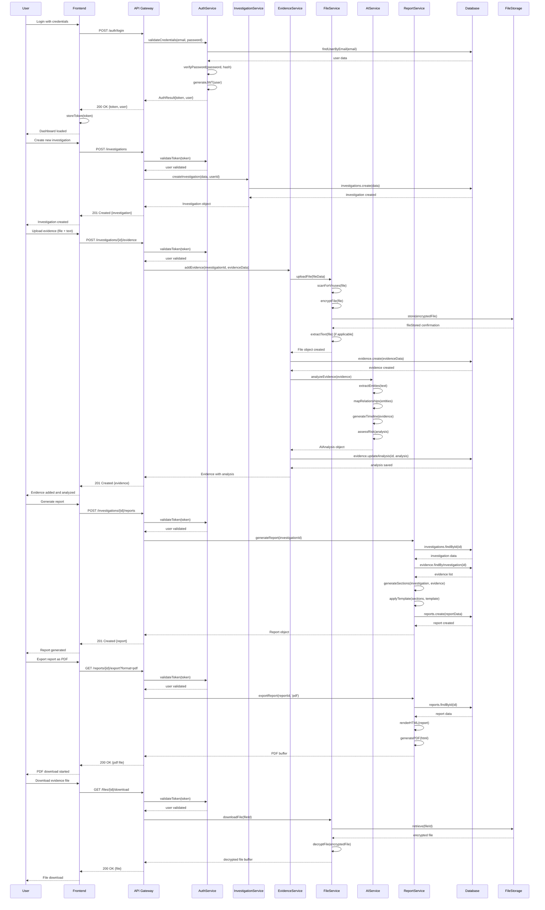

# OSINT Report Generator - System Architecture Design

## Implementation Approach

We will build a scalable, secure web-based OSINT report generator using a microservices architecture with React frontend and Node.js backend services. The system emphasizes security, modularity, and AI integration while maintaining high performance for professional investigators.

### Key Technical Decisions:
- **Frontend**: React 18 with TypeScript, Zustand for state management, Shadcn-ui components
- **Backend**: Node.js with Express, microservices architecture using Docker containers
- **Database**: PostgreSQL for structured data, Redis for caching, MinIO for file storage
- **AI Integration**: Google Gemini API with custom analysis pipeline
- **Security**: JWT authentication, AES-256 encryption, role-based access control
- **Export**: Puppeteer for PDF, mammoth.js for DOCX, custom HTML templates
- **Deployment**: Kubernetes on AWS/GCP with auto-scaling capabilities

### Difficult Points Analysis:
1. **AI Analysis Pipeline**: Complex data processing requiring entity extraction, relationship mapping, and timeline generation
2. **File Security**: Secure handling of sensitive investigative materials with encryption at rest and in transit
3. **Report Generation**: Dynamic template system that can handle various data types and maintain professional formatting
4. **Real-time Processing**: Ensuring sub-5 second AI response times while maintaining accuracy
5. **Scalability**: Supporting concurrent users with large file uploads and AI processing

## Data Structures and Interfaces

```mermaid
classDiagram
    class User {
        +string id
        +string email
        +string name
        +string role
        +string organizationId
        +DateTime createdAt
        +DateTime lastLogin
        +UserPreferences preferences
        +authenticate(credentials) boolean
        +hasPermission(action) boolean
        +updateProfile(data) void
    }

    class Organization {
        +string id
        +string name
        +string type
        +BrandingSettings branding
        +SecuritySettings security
        +SubscriptionPlan plan
        +createUser(userData) User
        +updateSettings(settings) void
    }

    class Investigation {
        +string id
        +string title
        +string description
        +string subjectName
        +string status
        +string userId
        +string organizationId
        +DateTime createdAt
        +DateTime updatedAt
        +InvestigationMetadata metadata
        +addEvidence(evidence) void
        +generateReport() Report
        +updateStatus(status) void
    }

    class Evidence {
        +string id
        +string investigationId
        +string type
        +string source
        +string content
        +File[] attachments
        +Tag[] tags
        +DateTime timestamp
        +AIAnalysis analysis
        +validate() boolean
        +analyze() AIAnalysis
        +addTag(tag) void
    }

    class File {
        +string id
        +string filename
        +string mimeType
        +number size
        +string hash
        +string encryptedPath
        +FileMetadata metadata
        +boolean isProcessed
        +upload(data) void
        +download() Buffer
        +delete() void
        +extractText() string
    }

    class AIAnalysis {
        +string id
        +string evidenceId
        +Entity[] entities
        +Relationship[] relationships
        +Timeline timeline
        +RiskAssessment risk
        +Insight[] insights
        +number confidence
        +DateTime analyzedAt
        +performEntityExtraction() Entity[]
        +mapRelationships() Relationship[]
        +generateInsights() Insight[]
        +assessRisk() RiskAssessment
    }

    class Entity {
        +string id
        +string type
        +string value
        +string source
        +number confidence
        +EntityMetadata metadata
        +validate() boolean
        +normalize() string
    }

    class Relationship {
        +string id
        +string sourceEntityId
        +string targetEntityId
        +string type
        +number strength
        +string evidence
        +calculateStrength() number
    }

    class Timeline {
        +string id
        +TimelineEvent[] events
        +DateTime startDate
        +DateTime endDate
        +addEvent(event) void
        +sortEvents() void
        +generateVisualization() object
    }

    class Report {
        +string id
        +string investigationId
        +string title
        +ReportSection[] sections
        +ReportMetadata metadata
        +string template
        +DateTime generatedAt
        +ReportStatus status
        +generateSections() ReportSection[]
        +exportToPDF() Buffer
        +exportToHTML() string
        +exportToDOCX() Buffer
        +preview() string
    }

    class ReportSection {
        +string id
        +string type
        +string title
        +string content
        +object data
        +string template
        +render() string
        +validate() boolean
    }

    class APIController {
        +AuthService authService
        +InvestigationService investigationService
        +EvidenceService evidenceService
        +AIService aiService
        +ReportService reportService
        +FileService fileService
        +handleRequest(request) Response
        +validateInput(data) boolean
        +handleError(error) Response
    }

    class AuthService {
        +UserRepository userRepository
        +JWTHelper jwtHelper
        +EncryptionService encryptionService
        +login(credentials) AuthResult
        +refreshToken(token) string
        +validatePermissions(user, action) boolean
        +logout(token) void
    }

    class InvestigationService {
        +InvestigationRepository repository
        +EvidenceService evidenceService
        +AIService aiService
        +createInvestigation(data) Investigation
        +updateInvestigation(id, data) Investigation
        +deleteInvestigation(id) void
        +getInvestigations(userId) Investigation[]
    }

    class EvidenceService {
        +EvidenceRepository repository
        +FileService fileService
        +AIService aiService
        +addEvidence(investigationId, data) Evidence
        +processEvidence(evidence) AIAnalysis
        +updateEvidence(id, data) Evidence
        +deleteEvidence(id) void
    }

    class AIService {
        +GeminiClient geminiClient
        +EntityExtractor entityExtractor
        +RelationshipMapper relationshipMapper
        +TimelineGenerator timelineGenerator
        +RiskAnalyzer riskAnalyzer
        +analyzeEvidence(evidence) AIAnalysis
        +extractEntities(text) Entity[]
        +mapRelationships(entities) Relationship[]
        +generateTimeline(evidence) Timeline
        +assessRisk(analysis) RiskAssessment
    }

    class ReportService {
        +ReportRepository repository
        +TemplateEngine templateEngine
        +PDFGenerator pdfGenerator
        +HTMLGenerator htmlGenerator
        +DOCXGenerator docxGenerator
        +generateReport(investigation) Report
        +exportReport(report, format) Buffer
        +previewReport(report) string
    }

    class FileService {
        +StorageAdapter storageAdapter
        +EncryptionService encryptionService
        +VirusScanner virusScanner
        +OCRProcessor ocrProcessor
        +uploadFile(data, metadata) File
        +downloadFile(id) Buffer
        +deleteFile(id) void
        +processFile(file) void
        +scanForViruses(file) ScanResult
    }

    class DatabaseRepository {
        <<abstract>>
        +Database database
        +create(data) object
        +findById(id) object
        +update(id, data) object
        +delete(id) void
        +find(criteria) object[]
    }

    class UserRepository {
        +create(userData) User
        +findByEmail(email) User
        +updateLastLogin(id) void
        +findByOrganization(orgId) User[]
    }

    class InvestigationRepository {
        +create(data) Investigation
        +findByUserId(userId) Investigation[]
        +updateStatus(id, status) void
        +findByDateRange(start, end) Investigation[]
    }

    class EvidenceRepository {
        +create(data) Evidence
        +findByInvestigation(investigationId) Evidence[]
        +updateAnalysis(id, analysis) void
        +findByType(type) Evidence[]
    }

    class ReportRepository {
        +create(data) Report
        +findByInvestigation(investigationId) Report[]
        +updateStatus(id, status) void
        +findRecent(userId, limit) Report[]
    }

    %% Relationships
    User ||--o{ Investigation : creates
    Organization ||--o{ User : contains
    Investigation ||--o{ Evidence : contains
    Evidence ||--o{ File : has
    Evidence ||--|| AIAnalysis : analyzed_by
    AIAnalysis ||--o{ Entity : extracts
    AIAnalysis ||--o{ Relationship : maps
    AIAnalysis ||--|| Timeline : generates
    Investigation ||--o{ Report : generates
    Report ||--o{ ReportSection : contains
    
    APIController --> AuthService : uses
    APIController --> InvestigationService : uses
    APIController --> EvidenceService : uses
    APIController --> ReportService : uses
    
    AuthService --> UserRepository : uses
    InvestigationService --> InvestigationRepository : uses
    EvidenceService --> EvidenceRepository : uses
    EvidenceService --> AIService : uses
    ReportService --> ReportRepository : uses
    
    UserRepository --|> DatabaseRepository : extends
    InvestigationRepository --|> DatabaseRepository : extends
    EvidenceRepository --|> DatabaseRepository : extends
    ReportRepository --|> DatabaseRepository : extends
```

## Program Call Flow



## Anything UNCLEAR

Several aspects need clarification for optimal implementation:

1. **AI Analysis Scope**: The specific types of entities and relationships to extract need definition. Should we focus on standard OSINT entities (names, emails, phones, addresses, social media handles) or include domain-specific entities for different investigation types?

2. **File Processing Limits**: Maximum file sizes, supported formats, and processing timeouts need specification. Should we implement tiered processing for different file sizes?

3. **Real-time vs Batch Processing**: For large evidence sets, should AI analysis be performed in real-time or queued for batch processing during off-peak hours?

4. **Data Retention Policies**: How long should investigation data be stored? Are there legal requirements for data deletion in different jurisdictions?

5. **Integration Requirements**: Should the system provide APIs for integration with existing OSINT tools (Maltego, Hunchly) or law enforcement databases?

6. **Compliance Standards**: Specific compliance requirements (CJIS, FedRAMP, ISO 27001) that may affect architecture decisions need clarification.

7. **Multi-tenancy Level**: Should organizations have completely isolated data or can some anonymized insights be shared for pattern recognition improvements?

8. **Backup and Recovery**: Requirements for data backup, disaster recovery, and business continuity planning need specification.

The system design assumes standard enterprise security practices and scalable cloud deployment, but these unclear areas could significantly impact implementation approach and resource requirements.